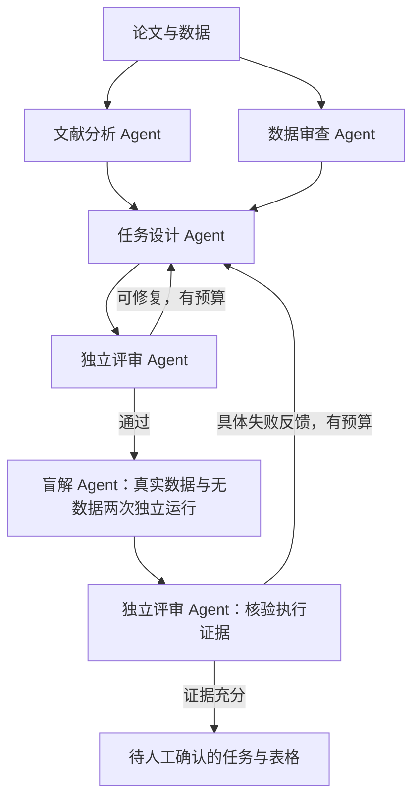

# Omics Task Agent

从论文与真实组学数据，构造需要持续分析和科研判断的任务。
初版采用五个专职 Agent，共享一个运行内核；不为每个角色建立配置文件。

## 分工与流程

| 角色 | 可见信息与工具 | 交付 |
|---|---|---|
| literature | 文献目录；read_source 按窗口读原文 | 精确引文、去重结论、条件与限制 |
| data | 数据描述与注册文件；inspect_data 只读预览 | 已观察结构、缺失项、不确定性 |
| designer | 文献证据、数据审查、修订反馈 | 单一研究目标、依赖里程碑、判断点与验收标准 |
| solver | 公开题目及所选数据；隔离环境中的 run_python/read_artifact | 分析代码、实际产物、结论或无法判断原因 |
| reviewer | 候选题、来源；验证阶段另看执行记录与产物预览 | 通过、具体修改建议或拒绝 |

每个角色使用独立上下文，可选独立模型；工具由代码授权，不能自行调用其他角色的工具。
同一模型担任不同角色仍可能有相关偏差，独立会话不等于独立科学证据。
角色按依赖顺序调度；初版不做并行执行，以保证断点和交接可追踪。



没有数据或不启用执行时，流程停在候选任务状态。每个 Agent 可以按需调用工具、读取结果、修正后继续；
主控负责有限修订、状态与交接，避免无限循环。上图的执行环节需要显式开启。

## 文件

| 文件 | 职责 |
|---|---|
| agent.py | CLI、角色调度、结构校验、断点、任务导出 |
| team.py | 共享 Agent 循环、工具注册、文献/数据读取、公开交接 |
| evaluate.py | Docker 盲解、无数据对照、执行评分与产物留存 |
| prompts.py | 五个角色的职责、输出契约与修订规则 |
| example.json | 唯一输入示例，合成 bulk RNA 场景 |
| test_agent.py | 离线行为测试及可选 Docker 集成测试 |
| .github/workflows/check.yml | 自动运行测试，不使用 LLM 密钥 |
| README.md / .gitignore | 使用说明 / 排除运行产物 |

没有每角色 JSON、独立 schema JSON、模型配置 JSON 或空目录。
增加角色优先扩展角色表、prompt 和工具映射；只有职责确实需要时才拆文件。

## 运行

Python 3.9+，macOS/Linux。编排、CSV 预览及离线演示只用标准库。
h5ad 结构预览可选安装 h5py；缺少它会明确报告未检查，而非伪装成功。

```bash
python3 agent.py --demo --out runs/demo
python3 agent.py --demo --out runs/demo
python3 -m unittest -v test_agent
```

第二次相同命令从断点恢复。演示是固定夹具，会走真实的文献读取、缺失文件检查和角色交接，
不调用 LLM，也不声称完成科研分析。

真实输入沿用 example.json 的结构：title、track、max_tasks、sources、data。
sources 提供论文文本与引用；data 提供路径及数据描述，路径相对于输入文件解析。
track 可取 method_reproduction、result_reproduction、exploration。
数据描述应写样本、测量、分组与标识含义，避免包含目标结论；公开数据自身的答案泄漏仍需检查。

配置 OPENAI_API_KEY、OPENAI_MODEL；可选 OPENAI_BASE_URL（默认 OpenAI 兼容 chat/completions 接口）。
GitHub 登录不等于模型 API 凭证。

```bash
python3 agent.py input.json --out runs/study
python3 agent.py input.json --out runs/study-review \
  --role-model reviewer=YOUR_REVIEW_MODEL --max-turns 12 --max-revisions 1
```

--role-model 可重复，角色名为 literature/data/designer/solver/reviewer。
不指定的角色共享默认模型，各会话上下文仍然独立。初版支持同一个 API endpoint；
不同供应商可用兼容网关，或替换 Client。每个 Agent 默认最多 8 轮；
数据审查至少需要“文件数 + 1”轮，文件多时提高 --max-turns，最大 64。

## 实际盲解与对照

提前准备可信的 Python Docker 镜像，其中安装分析所需软件。程序只使用已有镜像并固定镜像 ID，
不自动拉镜像、不把生成代码退回宿主机执行。代码无网络、输入只读、容器有限时与资源限制。

```bash
python3 agent.py input.json --out runs/verified \
  --verify --image YOUR_LOCAL_ANALYSIS_IMAGE --max-turns 16 --execution-timeout 60
```

每题真实数据、无数据分别使用新会话和新工作目录。仅挂载该题选中的文件，
使用中性文件名，不挂载作者目录、参考答案、API 密钥或其他题目文件。
公开交接按字段白名单构造，移除来源、参考答案、审查意见以及私有验收/决策文字。
题面、公开里程碑和数据描述中的语义泄漏仍由评审与对照检查，不能靠删字段完全保证。

执行失败或评分要求修改时，将具体反馈退给 designer，再经 reviewer 审查并用新会话重做；
每题最多 --max-revisions 次执行后修订，另有同样上限的出题阶段修订。
两个阶段预算独立，均不会无限重试。--max-revisions 0 可禁用修订。

基础容器上限为 2 CPU、4 GiB 内存、128 进程、单文件 16 MiB；执行超时默认 60 秒。
这些是小规模试题验证的初始值，不适合直接跑完整大型组学项目。
GPU、集群作业、较大产物与更长预算通过替换执行后端扩展；没有默认申请 GPU。

## 输出和状态

只有开始运行才生成 runs/ 下的产物；均不提交 GitHub：

- tasks.csv：可直接打开的调研/任务表。
- tasks.json：完整作者侧任务、证据、审查、验证结果。
- state.json：统一保存角色调用、工具轨迹与断点，不为每个阶段单独写 JSON。
- artifacts/：实际执行时保留的分析输出，以运行键定位，名称与校验值见验证记录。
- solver.json：仅加 --export-solver 才生成，用于交给外部求解器；默认在内存交接。

状态包括 demo_only、needs_data、needs_execution、needs_revision、rejected、needs_human_review。
execution_verified 表示执行记录、产物与模型评审通过，并非专家认证。
no_data_control_verified 表示无数据时明确无法判断且评审支持数据依赖；不等于逐题因果证明。
benchmark_ready 始终为 false，需补人工核验、稳定性与更严格对照，避免自动宣称题目已成为金标准。

文件存在和哈希检查不等于数据审查；CSV 只预览前 64 KiB/5 行，h5ad 只检查结构与字段。
独立评审读取代码、执行结果和产物预览；预览不够时应要求补充检查。
无数据对照已实现，错配数据/标签扰动尚未实现。

已完成的模型调用与工具观察会缓存；输入、代码、模型、预算、数据哈希变化时拒绝复用旧目录。
工具执行中断时不自动重放潜在副作用；临时求解工作区丢失时需换输出目录。
已完整保存的验证运行可以恢复，产物被更改或丢失会阻止复用。
这不是任意中断点的容器快照恢复。

## 扩展接口

- 新工具：注册 team.Tool(description, callable)，仅授予需要的角色。
- 新模型：实现 Client(stage, system, payload) -> JSON 字符串，或用 --role-model。
- 新执行后端：实现 DockerRunner 的 tools()/artifact()/receipts/work 契约，传给 verify 的 runner_factory。
- 新评分器：在 evaluate.py 添加可计算的检查，再与独立评审结合；不要只比对论文预期答案。
- 文献搜索与 PDF 解析：接在 sources 输入之前；当前版本读取提供的文本，不包含联网自动搜文献。

设计借鉴 [HeurekaBench](https://github.com/mlbio-epfl/HeurekaBench/tree/c2a2b2fcdc5244220ff60f65483bc084c72a8cf1/scheurekabench)
的单一评估目标、数据依赖、明确契约及条件保留，以及
[BaisBench](https://github.com/EperLuo/BaisBench/tree/cfab1beb09a7cba999c16f01475fdca37fee5cac)
的论文/数据对应、求解器适配和执行评测。这里保留长程依赖与判断点，不强制把输出做成选择题。
