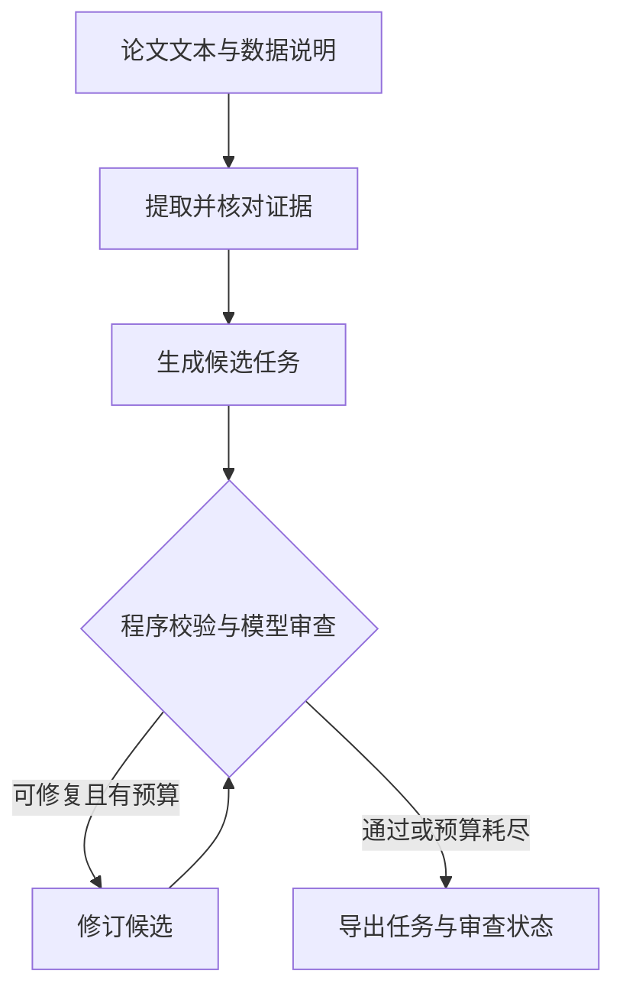

# Omics Task Agent

从论文证据和数据说明生成需要研究判断的组学任务。初版只保留一条顺序工作流，支持有限修订、断点续跑和表格输出。适用于 bulk、单细胞及多组学。

**当前产物是候选题，不是已经执行验证的 benchmark。** 引用对齐、格式通过、模型审查通过，都不能证明实际数据足够或研究结论正确。

## 文件

| 文件 | 职责 |
| --- | --- |
| `agent.py` | 模型调用、程序校验、流程状态、结果导出 |
| `prompts.py` | 提取、出题、审查、修订四个 prompt |
| `example.json` | 合成示例和输入格式 |
| `README.md` | 运行方式、设计边界、借鉴来源 |
| `.gitignore` | 排除密钥、缓存和运行结果 |

Python 3.9+，macOS/Linux，全部使用标准库。没有数据库、Web UI、Agent 框架或额外配置层。

## 工作流



证据不足可以产生零道题。程序检查引用、ID、依赖图和输出契约；模型审查单目标、数据依赖、判断需求、答案泄漏和科学条件。两类检查分开记录。

一个任务可以包含相互依赖的多个里程碑，每个里程碑只有一个主要评分目标。里程碑记录前置步骤、研究判断、预期产物和验收标准。最低结构要求是至少两个相连节点及一个判断字段；**这只是筛选条件，不是长程能力或真实判断难度的证明**。

## 先运行离线示例

```bash
python3 agent.py --demo --out runs/demo
```

不调用 API，不需要 GPU。固定的合成输入与固定响应只用于检查流程，所有任务标为 `demo_only`。示例不是论文、真实数据分析或真实模型评测，不能加入题库。再次运行同一命令会复用断点。

## 接入模型

复制 `example.json` 为自己的输入，替换为有权使用的论文正文或代码片段、来源信息和数据说明。`sources[].text` 是实际文本，`citation` 是其出处，不会自动下载 URL 或解析 PDF。`data[].path` 是相对输入 JSON 所在目录的本地文件路径，也可以为 `null` 表示待提供。

```bash
export OPENAI_API_KEY='你的API密钥'
export OPENAI_MODEL='你有权限使用的模型ID'
python3 agent.py input.json --out runs/paper01
```

使用支持 Chat Completions、JSON object 输出和 `max_completion_tokens` 的接口。模型 ID 由你指定，不预设模型权限。可用 `OPENAI_BASE_URL` 或 `--base-url` 指定兼容服务的 `/v1` 地址。GitHub 连接和 ChatGPT 订阅不会自动提供此 API 密钥。

调用会将输入文本、数据描述、文件路径、文件哈希和候选任务发到指定模型接口；不会上传矩阵文件内容。文件存在性与 SHA-256 由程序检查，数据列、模态层和科学适用性尚未检查。服务不兼容会明确报错，不静默换模型或绕过校验。

`track` 有三个值：

| 值 | 方法要求 |
| --- | --- |
| `method_reproduction` | 可要求复现论文报告的方法 |
| `result_reproduction` | 允许有依据的替代方法，重心是结果验证 |
| `exploration` | 允许提出新假设；预期答案不能冒充已证实结果 |

默认最多修订一轮，可设 `--max-revisions 0` 或 `2`。一轮修订最多涉及五次模型调用：提取、生成、审查、修订、再审查。HTTP 失败和无效 JSON 会停止并保留状态，不自动重复收费请求。有效 JSON 的任务结构错误可以进入有限修订。

## 输出与续跑

| 自动生成文件 | 内容 |
| --- | --- |
| `tasks.json` | 作者侧完整记录：证据、任务、预期答案、审查和验证状态 |
| `tasks.csv` | Excel 可直接打开的任务概览，UTF-8 BOM |
| `solver.json` | 求解器侧输入：题目、数据说明、里程碑；不包含论文正文、参考答案或审查意见 |
| `state.json` | 阶段响应和请求指纹，用于续跑与审计 |

输出目录另有运行锁 `.run.lock`。不同任务使用不同 `--out`，同目录不允许并发运行。相同命令自动复用已有响应；输入、数据文件内容、代码、模型或修订预算发生变化时，必须换一个输出目录。损坏或无效的缓存响应不会被当作成功结果跳过。

最终状态：`needs_data`、`needs_execution`、`needs_revision`、`rejected` 或 `demo_only`。零任务时原因保留在 `gaps`。格式修复耗尽后以退出码 2 返回，原始草稿仍在 `state.json`；格式通过但语义未通过的候选仍导出以便审查。

`benchmark_ready`、`execution_verified`、`no_data_control_verified` 在当前版本不会被设为真。`solver.json` 只在字段层面剥离作者答案；题目措辞是否泄漏仍由模型审查，尚未通过独立对照实测。`tasks.json` 和 `tasks.csv` 是作者材料，不应提供给答题模型。

## 借鉴了什么

参考 [HeurekaBench 固定版本](https://github.com/mlbio-epfl/HeurekaBench/tree/c2a2b2fcdc5244220ff60f65483bc084c72a8cf1/scheurekabench) 的流程与 prompt 设计。这里重新编写了适合当前任务的指令，没有复制其实现或整套模板。R 编号来自[逐条精读文档](https://chatgpt.com/space/page_4bee53909cec8191838d1122f12c888f)，不是上游代码编号。

| 学到的要求 | 初版实现 | 必要边界 |
| --- | --- | --- |
| R003–R005：基于推导和证据 | 原句引用与来源 ID，程序精确匹配 | 匹配只能证明原文存在，不能证明它支持全部主张 |
| R010–R012、R029：单焦点并拆分 | 里程碑单目标及显式依赖 | 保留多步骤任务；不按 `and` 机械拆题 |
| R013–R015：需要数据与判断 | 五项模型审查、产物与验收字段 | 尚需真实执行和无数据对照 |
| R026–R029：用反例指导修复 | 审查输出具体理由，有限修订 | 不能为隐藏答案删除必要人群或实验条件 |
| 输出契约一致 | 四个 prompt 都返回合法 JSON，程序检查类型和引用 | 不把合法格式当科学正确 |
| 不反复寻找预期显著性 | prompt 接受有效阴性和合理不确定性 | 后续执行器还需实际落实停止规则 |

## 下一步只补必要能力

用一篇真实组学论文及可用数据走通当前流程，再接一个隔离的执行验证器：检查数据能力、实际解题、核验产物、运行无数据对照。验证前不能把论文作者结论当执行金标。文献搜索可接已有检索流程，当前不重复建一个搜索项目。暂不需要训练模型或申请 GPU；是否使用 GPU 由后续具体分析决定。

API 契约参考：[OpenAI Chat Completions](https://developers.openai.com/api/reference/resources/chat)。当前仅完成离线与本地接口测试，未进行付费模型调用或真实组学复现。
